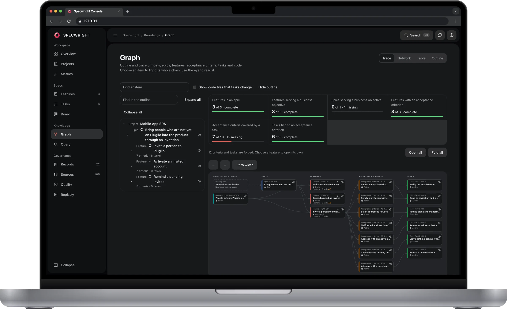
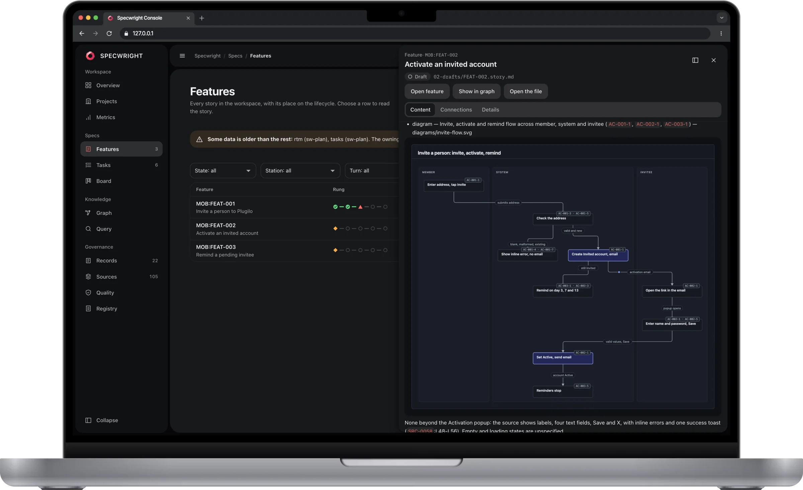

<p align="center">
  
</p>
<h2 align="center">SPEC-WRIGHT</h2>
<p align="center">
  <strong>From raw idea to implementation-ready work.</strong><br />
  Nine portable agent skills. One trail of evidence.<br />
</p>
<p align="center">
  <code>SHAPE</code> &nbsp;▸&nbsp; <code>SPEC</code> &nbsp;▸&nbsp; <code>REVIEW</code> &nbsp;▸&nbsp; <code>PLAN</code> &nbsp;▸&nbsp; <code>MARKDOWN READY</code><br />
</p>
<p align="center">
  
  
  
</p>


---

## `01` — What you get

A rough idea goes in. A story, a plan, and a task list come out. Product, engineering, and QA can read the same files.

- Each skill stands on its own and travels with your agent.
- Work is saved in files, so the next chat can pick up where this one stopped.
- IDs stay put. A withdrawn ID becomes a tombstone and is never reused.

Two roles, five skills. The BA turns an idea into accepted stories and tasks; the Dev turns
those into a very detailed plan. One person may play both — then one confirm switches over.

| You ask for | Skill | You get |
| --- | --- | --- |
| Start or resume | `sw-start` | A board for one item, and a guarded next step |
| Craft (the BA line) | `sw-craft` | Sources as frozen snapshots; a gap table of what a feature should do against what code and tests do today, with `CODE:` citations; a problem-led brief, an accepted INVEST split and reserved features; requirements and acceptance criteria you can observe, with diagrams; the task breakdown; then your plain-words accept, bound to a content hash (formal sign-off when you require it) |
| Forge (the Dev plan) | `sw-forge` | A very detailed plan: exact files per task, the change itself, the test that proves it and the command that runs it; one ready prompt per task; and real task status (`planned`, `in-progress`, `done` with evidence, `blocked`) |
| Ship (optional) | `sw-ship` | A delivery you asked for: epic, story or tasks to Jira, behind a scope question, a dry-run and a fresh yes |
| View | `sw-view` | A local, read-only web console: overview, metrics, features, tasks, a kanban board, and the knowledge graph (trace, network, table, outline) with queries |

Craft ends at the finalize and says "Say **forge** to plan FEAT-001". It never crosses into the
Dev role on its own; the code is written elsewhere, from the prompts forge generates.

### See it

`sw-view` opens a local, read-only console on `127.0.0.1`. It never writes a spec file.

**The trace.** Objectives, epics and features sit side by side. A feature's criteria and tasks stay folded into a count (`7 criteria · 6 tasks`, `▲` for open work) until you choose it. Then only its own fan out beside it, and the previous one folds back.

<p align="center">
  
</p>

**The story, with its picture.** Choose any item and its file opens in a panel on the right: the story with the criterion lines marked, and the flow diagram that `sw-craft` drew, embedded in the story as an SVG.

<p align="center">
  
</p>

Every artifact has a stable ID, a title and aliases, and `graph.py show <any name>` finds it by a legacy ID, a remote page ID or a title fragment. The build also writes `_meta/INDEX.md`, `CROSSWALK.tsv` and `READ-FIRST.md`, so a new session can start from one short list instead of crawling folders. A project that already runs many capabilities starts from its legacy register (`sw-start` routes it), imports a page tree in one logged batch, and checks every citation by script.

## `02` — Install

Four ways in. Pick the one that matches the machine in front of you.

- **To install the skills:** `curl` or `irm`. No Node, no Python.
- **To run the skills:** Python 3.10+ and Git. The standard library is enough. A shell script (no Python needed) checks for it and offers the install command.
- **To open the console (`sw-view`):** Node 24+. `sw-start` offers to install it, and only after you say yes.
- **Richer documents** can use local tools such as pandoc. A missing tool says so. It never invents the document.

A new docs workspace starts a Git repo only when it is not already inside one. An embedded workspace reuses the code repo, including worktrees. Setup does not change Git config or stage files. Each skill command then ends with a checkpoint commit of its own spec files (see House rules). New workspaces default to Markdown.

### Upgrading an existing install

From the unzipped new kit:

```sh
sh migrate.sh --dry-run ~/.claude/skills     # see the plan
sh migrate.sh ~/.claude/skills               # replace old sw-* skills, back them up beside it
sh migrate.sh /path/to/your/kit-checkout     # replace kit folders; workshop/ and other tests stay
sh migrate.sh --flow-auto /path/to/spec-repo # refresh AGENTS.md, switch to automatic hand-off
```

It detects the target kind, refuses a folder that is not Specwright, and never deletes spec work.

### Command-line installer

> [!TIP]
> The easy door. All five skills, for the agents you pick. All projects is the default.

All projects:

```sh
curl -fsSL https://raw.githubusercontent.com/jonaskahn/specwright/main/install.sh | sh
```

This project:

```sh
curl -fsSL https://raw.githubusercontent.com/jonaskahn/specwright/main/install.sh | sh -s -- --project
```

Named agents, no questions:

```sh
curl -fsSL https://raw.githubusercontent.com/jonaskahn/specwright/main/install.sh | sh -s -- --agent cursor --agent claude-code -y
```

Windows, all projects:

```powershell
irm https://raw.githubusercontent.com/jonaskahn/specwright/main/install.ps1 | iex
```

Windows, this project:

```powershell
& ([scriptblock]::Create((irm https://raw.githubusercontent.com/jonaskahn/specwright/main/install.ps1))) -Project
```

Windows, named agents, no questions:

```powershell
& ([scriptblock]::Create((irm https://raw.githubusercontent.com/jonaskahn/specwright/main/install.ps1))) -Agent cursor,claude-code -Yes
```

A released version instead of the main branch:

```sh
curl -fsSL https://raw.githubusercontent.com/jonaskahn/specwright/main/install.sh | sh -s -- --version 0.9.0
```

```powershell
& ([scriptblock]::Create((irm https://raw.githubusercontent.com/jonaskahn/specwright/main/install.ps1))) -Version 0.9.0 -Yes
```

- macOS and Linux need `curl` or `wget`, plus `tar`. Windows needs PowerShell and `tar`.
- All projects is the default. `--project` / `-Project` installs into this project only.
- Skip the questions with `-y` / `-Yes`. Detected agents are used. If none show up, Universal gets the skills.
- A checkout that contains the installer is the source. Otherwise the script downloads `main`.
- An existing Specwright `sw-*` skill is replaced. A same-named folder that is not Specwright stops the install.

### Skills CLI

> [!NOTE]
> Same five skills, through `npx`. Node comes along for the ride.

All projects:

```sh
npx skills add jonaskahn/specwright -g
```

This project:

```sh
npx skills add jonaskahn/specwright
```

This path and the Claude plugin install the skills as they are in the repo, including all 45 diagram types. Zip builds from `workshop/tools/package.py` default to the core set of 35.

### Claude Code plugin

> [!NOTE]
> Claude Code, from the marketplace.

Add the marketplace:

```text
/plugin marketplace add jonaskahn/specwright
```

Install the plugin:

```text
/plugin install specwright@specwright
```

### Air-gapped installation

> [!WARNING]
> No network. A checkout, Python 3.10+, and a couple of local scripts.

Install into a project:

```sh
python3 workshop/tools/install.py --target /absolute/path/to/spec-repo
```

Build skill zips:

```sh
python3 workshop/tools/package.py --zip --out dist
```

This one also writes project instruction files.

### Talk to your agent

Plain language is enough. `sw-start` finds the workspace and sends you to the right skill.

```text
"start a spec for the refunds flow"
"turn this doc into testable acceptance criteria"
"draw the refunds flow as a diagram"
"analyse the refunds feature: what is actually built?"
"resume REF:FEAT-004"
"show the board for EPIC-001"
"send FEAT-004 to review"
"plan FEAT-004 after its approval"
"step FEAT-004 back to spec"
"does this new policy conflict with FEAT-004?"
"publish FEAT-004 to Jira"
"continue"
"spec FEAT-004 and stop after review"
```

Each stage reads the files before it asks you anything, so you can close the chat and come back later.

## `03` — How a feature moves


One feature walks the path after its epic split is accepted. Its siblings mind their own stations: `FEAT-004` can sit in spec while `FEAT-002` already has a plan.

- Stations hand off on their own. When spec finishes cleanly, review starts in the same turn; when you accept, plan starts. No "continue?" between skills.
- The run stops only for you: accepting a split, accepting a story, a blocking question, a check that stays red, or a missing input. Each stop asks everything at once.
- Say `continue` (or `/sw-continue`) in any chat, at any state. The board is read from files and the run picks up at the right station.
- A passing plan hands you the story, the approach, and the tasks.
- Publishing waits for a separate request. A saved Jira preference is not a yes.
- Prefer a pause per station? `workspace.py governance set flow guided` (one yes per station) or `step`.

Shared helpers for knowledge, trace, lint, status, assets, and visuals live in `skills/_shared/`. Packaging copies what each skill needs into its own folder.

### Existing systems and features

Install the kit at any point in a project's life. The kit adapts to what it finds:

- **Code inside or beside the docs.** It detects the repository it sits in and neighbouring repos with build files (`../shop-api`, `../shop-web`), and registers them after one yes. No code is fine too.
- **Light inventory.** Endpoints, screens, entities, tests and doc headings, grouped into candidate features: names and pointers only, cheap on any repo size.
- **Gap table per feature.** `sw-craft` compares what a feature should do (docs, Jira, another system, the owner) with what code and tests do today, criterion by criterion: done, partial, missing, divergent or unknown, each with a `CODE:` citation that goes stale when the code changes. Code and documents weigh the same; disagreements become questions.
- **The shape decides the next step.** Nothing built → a new story. All done → the feature's version 1. Some gaps → version 1 plus a completion change. Code wrong → a fix.

### Changes, fixes and finalize

- **Version 1 of a live feature** comes from a confirmed analysis: only behaviour the code really has.
- **Change or fix** with a story that names its target, a Delta (criteria changed, added, removed) and a "must not change" list, bound to the target's hash so a stale change is caught.
- **Pre-ship check.** Shipping needs a verification table: one row per criterion, cited to code, marked done. Gaps block the ship unless you give a reason, which is recorded.
- **Ship and merge.** The kit records the git commit of each code root, merges the change into the feature as the next version with a changelog line, and sends the feature back for your finalize. Git keeps old versions.
- **Finalize, not click-through.** Three independent reviewers (critic, builder, tester) challenge each draft with evidence; the author fixes or rebuts. You then see a review pack: what is new to you since your last finalize, assumptions, existing-behaviour gaps and every dispute still standing.
- **Optional Jira status sync.** Opt in once; local state (accepted, planned, shipped, withdrawn) maps to Jira statuses in a dry-run table; transitions run only after your yes. Jira ahead of the files is reported as drift, never pulled back.

### Foundation story for new codebases

After the stack step, a new project gets one story before any feature: project structure, format, lint, tests with a coverage floor, one `make check` gate, CI and an AI workflow file. The kit asks up to five prefilled questions (tools per layer, coverage floor, CI and hooks, AGENTS.md) and checks current tool guidance before asking. It drafts the story and reference files: a `Makefile` with `setup · fmt · fmt-check · lint · typecheck · test · build · check`, an `AGENTS.md` with the stack, commands, structure, working principles (adapted from multica-ai/andrej-karpathy-skills) and definition of done, and a `CLAUDE.md` that imports it.

### Stack lock and agent prompts

- `sw-start` reads your build files (Maven, Gradle, npm, Python, Go, Flutter, .NET, compose, Terraform) and proposes a stack profile. You lock it once; the lock is bound to the profile's hash.
- Stories stay technology-free. Every code task carries a `Stack:` line, and a task that names a technology outside the lock stops the run.
- `sw-forge` writes `03-plan/prompts/FEAT-NNN/TASK-…md`: goal, Done when, the criteria word for word, the rules, the task's own plan section, the stack line, inputs, the test command and when to stop. Hand them to Claude Code or another agent, one task per session.
- Artifacts are written for agents: concrete values, no hedges, no filler. A style check flags the rest.

### Back from files, not from memory

The board is rebuilt from saved files: station, condition, blockers, and what you can do next.

- A reserved feature shows up before its story file exists.
- Two candidates means you choose, even when they share a station.
- A stale graph cannot decide the next step for you.
- Step-back and reset keep the files and the IDs.
- Returning to spec retires the active approval and keeps the history. Unchanged text keeps the same hash.
- Published requirements stay published. A change needs a current baseline and a change request.
- New evidence can quote a conflict. Importing it does not rewrite the story.
- An accepted edit gets an exact backup, outside the active scan.

## `04` — House rules

> Traceable changes. Explicit reviews. Deliberate publishing.

- **Published text wins.** Jira is the authority after publication. Local work uses frozen snapshots.
- **One skill may publish.** `sw-ship` is the only writer to Jira or Confluence. It wants an accepted story, a quality gate, a three-way dry-run, and a fresh yes for that exact plan. A plan is not needed, and Jira is used only when configured or asked for.
- **Every command ends with a git checkpoint.** The spec files a command changed are committed (`<skill>: <what changed>`, no trailer) and, when the repository has a remote, pushed: never forced, never past a failing hook, never touching your other work. Set `checkpoint: commit` or `off` in `project.yaml` (or `workspace.yaml`) to stop pushing or committing. See `skills/_shared/references/checkpoint.md`.
- **Approval is bound to the content.** `sw-craft` records it: your plain accept with the matching hash, or with `signoff: required` a named role, the item, a URL, and a matching hash. Old evidence cannot revive an invalidated approval. See `skills/_shared/references/governance.md`.
- **Named items move alone.** "Resume FEAT-004" moves only FEAT-004; "continue" moves the whole scope, station by station. Draft questions stay in spec. Asking about published content does not start a sync.
- **Imports are data.** Documents, issue text, and web pages are not instructions.
- **Lint before hand-off.** Do not weaken a rule to make a check pass.

## `05` — More to read

- [Installation](docs/install.md)
- [Security](docs/security.md)
- [Conventions](docs/conventions.md)
- [Sources](docs/sources.md)
- [Glossary](docs/glossary.md)

## `06` — If you hack on this

Lint first:

```sh
make lint
```

Then the tests, in Docker. The repo is mounted read-only. Git is there for workspace fixtures:

```sh
docker run --rm -v "$PWD:/workspace:ro" -w /workspace python:3.13-slim \
  sh -ec 'apt-get update -qq &&
          apt-get install -y -qq --no-install-recommends git &&
          PYTHONDONTWRITEBYTECODE=1 python -m unittest discover -s workshop/tests -t workshop &&
          PYTHONDONTWRITEBYTECODE=1 python -m unittest discover -s tests'
```

`make test` runs the same suite locally.

- The real runtime is `skills/_shared/`. Each skill folder carries a generated copy so it still works alone.
- Two test roots, both run above: `workshop/tests` is the toolkit suite, `tests/` covers the skill libraries (`analyze`, `foundation`, `handoff`, `review_merge`, `ship_sync`, `stack_style`).
- `workshop/tools/vendor.py --write` refreshes those copies. `--check` verifies them.
- Trigger evals are fixtures. They are not a score of model accuracy.
- Publish tests talk to a local Jira mock. They never touch a real Jira site.
- Production use needs a sandbox trial and a human sign-off.

## `07` — License

MIT. See [LICENSE](LICENSE) and [NOTICE](NOTICE).

---

<p align="center">
  <sub>SPECWRIGHT · MAKE THE WORK TRACEABLE</sub>
</p>
